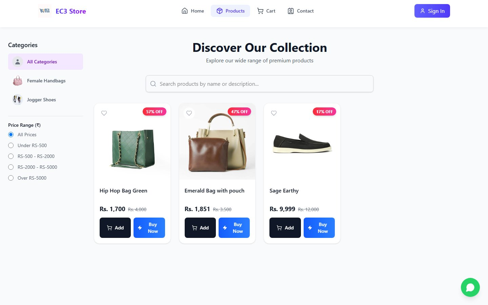

# EC3 Store

**A full-stack e-commerce store built with React and Firebase: browse and filter products, check out with Stripe or cash on delivery, and manage everything from an admin dashboard.**

[](https://ec3store.vercel.app)
[](https://github.com/Umair-Habibx123/ec3-store/actions/workflows/ci.yml)
[](LICENSE)

**Status:** a portfolio project, actively maintained (last updated November 2026).

**[Open the live store](https://ec3store.vercel.app)**


## Features

**For shoppers**
- **Browse and find:** filter by category and price range, and search by name or description.
- **Cart and Buy Now:** buy several items through the cart, or a single item straight away.
- **Checkout:** pay by card with [Stripe Checkout](https://stripe.com/payments/checkout), or choose cash on delivery.
- **After ordering:** track orders under **My Orders**, and manage your profile and saved addresses. Cash-on-delivery orders also send a confirmation email.

**For admins**
- **Dashboard:** add and edit products with image uploads, manage users, and move orders through pending, confirmed, shipped, delivered or cancelled.
- **Access control:** admin pages are protected by role, stored on the user's account.

**Secure checkout**
- **Server-side pricing:** prices are recalculated from the database, so the browser never decides what a customer pays.
- **Verified payments:** a Stripe webhook verifies each payment's signature before marking the order paid.



## Quick start

You need **Node.js 20+** and a Firebase project with Authentication and Firestore enabled. Stripe, Cloudinary and EmailJS are only needed for card payments, image uploads and emails.

```bash
git clone https://github.com/Umair-Habibx123/ec3-store.git
cd ec3-store
npm install
cp .env.example .env      # then fill in your keys; .env.example explains each one
npm run dev
```

Open **http://localhost:5173**. `npm run dev` also serves the payment API locally, so you don't need the Vercel CLI.

To test card payments locally, install the [Stripe CLI](https://stripe.com/docs/stripe-cli) and run `npm run dev:all`. It starts the app and forwards Stripe events to your local webhook.

| Command | What it does |
|---|---|
| `npm run dev` | Starts the app and the `/api` functions at http://localhost:5173 |
| `npm run dev:all` | Same, plus Stripe webhook forwarding |
| `npm run build` | Builds the production site into `dist/` |
| `npm run lint` | Checks the code with ESLint |

## How it's built

| Part | What it uses |
|---|---|
| Frontend | React 19, React Router 7, Tailwind CSS 4, built with Vite |
| Data and accounts | Firebase Authentication and Firestore |
| Payments | Stripe Checkout, through Vercel serverless functions in `api/` |
| Images | Cloudinary uploads, with an unsigned upload preset |
| Emails | EmailJS confirmations for cash-on-delivery orders |
| Hosting | Vercel |

```
src/components/      pages: home, catalog, product, cart, checkout, orders, settings, admin dashboard
src/context/         signed-in user, role and protected routes
src/utils/           Stripe checkout, image upload, product helpers
api/                 Vercel functions: create a checkout session, handle the Stripe webhook
dev/apiPlugin.mjs    serves api/ locally during npm run dev
```

## Security notes

- **No secrets in the browser:** server keys (Stripe and Firebase Admin) are only read by the functions in `api/`. Every `VITE_` variable is public, so `.env.example` lists only public values under that prefix.
- **Firestore rules aren't in this repo.** If you deploy your own copy, write rules that only let admins change products, users and other people's orders.

## License

[MIT](LICENSE) © 2026 [Umair Habib](https://github.com/Umair-Habibx123). Product photos are demo data.
